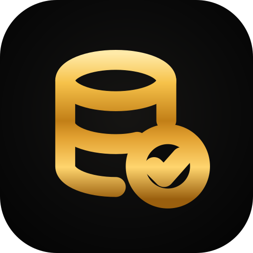
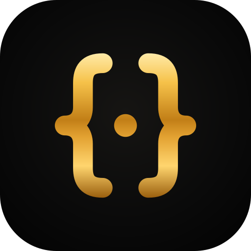

<div align="center">


# Cyba Security Clarity Skills Marketplace

[](https://cybasecurity.io/)
[](https://x.com/cybasecurity)
[](https://t.me/CybaSecurity)
[](https://github.com/cybasecurity)
[](mailto:contact@cybasecurity.io)

</div>

## Overview

Clarity skills give an AI coding agent the Clarity and Stacks knowledge it lacks, for building, testing, auditing and shipping contracts on Stacks. The set is a router, `clarity:start`, which picks the skills a task needs, and 21 focused skills. They work in Claude Code, Codex, Gemini CLI, Google Antigravity, OpenCode and any tool that reads [Agent Skills](https://agentskills.io/specification).

## Installation

The skills link to each other: install the whole set, never a single folder. Install it separately in each tool you use. The [install guide](https://github.com/cybasecurity/clarity-skills/blob/main/docs/INSTALL.md) has every host's steps, including updates, removal and team setup.

| Host | Install | Startup hook | Skills appear as |
|---|---|---|---|
| [Claude Code](https://github.com/cybasecurity/clarity-skills/blob/main/docs/INSTALL.md#claude-code) | Plugin marketplace | Yes | `/clarity:start` |
| [Codex CLI](https://github.com/cybasecurity/clarity-skills/blob/main/docs/INSTALL.md#codex-cli) | Plugin marketplace | Yes, after you review it | `$clarity:start` |
| [Gemini CLI](https://github.com/cybasecurity/clarity-skills/blob/main/docs/INSTALL.md#gemini-cli) | Extension | No; the router loads as context | `clarity-start` |
| [Google Antigravity](https://github.com/cybasecurity/clarity-skills/blob/main/docs/INSTALL.md#google-antigravity) | Plugin | No | `/clarity-start` |
| [OpenCode](https://github.com/cybasecurity/clarity-skills/blob/main/docs/INSTALL.md#opencode) | Clone and add the folder to the config | No | `clarity-start` |
| [Other agents](https://github.com/cybasecurity/clarity-skills/blob/main/docs/INSTALL.md#other-agents) | Skills CLI, ask your agent, copy, or point at the router | No | `clarity-start` |
| [Coming soon](https://github.com/cybasecurity/clarity-skills/blob/main/docs/INSTALL.md#coming-soon) | Claude apps, ChatGPT, GitHub Copilot and VS Code, Factory Droid, Devin CLI, Cline, Kiro, Cursor, and the Claude and ChatGPT directories | | |

Claude Code:

```text
/plugin marketplace add cybasecurity/clarity-skills
/plugin install clarity@clarity-skills
```

Codex CLI:

```sh
codex plugin marketplace add cybasecurity/clarity-skills
codex plugin add clarity@clarity-skills
```

Gemini CLI:

```sh
gemini extensions install https://github.com/cybasecurity/clarity-skills
```

Any other agent that reads Agent Skills: paste this into its chat.

```text
Install the Clarity skills from https://github.com/cybasecurity/clarity-skills: copy every folder in its skills/ directory into your skills directory, then use clarity-start for Clarity and Stacks tasks.
```

Where the startup hook doesn't run, begin a Clarity task by asking for the router (`clarity-start`), or add the project instruction from [Other agents](https://github.com/cybasecurity/clarity-skills/blob/main/docs/INSTALL.md#other-agents).

## Skills

### Router

| Skill&nbsp;&nbsp;&nbsp;&nbsp;&nbsp;&nbsp;&nbsp;&nbsp;&nbsp;&nbsp;&nbsp;&nbsp;&nbsp;&nbsp;&nbsp;&nbsp;&nbsp;&nbsp;&nbsp;&nbsp;&nbsp;&nbsp;&nbsp;&nbsp;&nbsp;&nbsp;&nbsp;&nbsp;&nbsp;&nbsp;&nbsp;&nbsp;&nbsp;&nbsp;&nbsp;&nbsp;&nbsp;&nbsp;&nbsp;&nbsp;&nbsp;&nbsp;&nbsp;&nbsp;&nbsp;&nbsp;&nbsp;&nbsp; | Load it for |
|---|---|
| &nbsp;[clarity:start](plugin/skills/start/SKILL.md) | Router: which skills to load for any Clarity task, and the checklist to pass before calling a contract done. |

### Write

| Skill&nbsp;&nbsp;&nbsp;&nbsp;&nbsp;&nbsp;&nbsp;&nbsp;&nbsp;&nbsp;&nbsp;&nbsp;&nbsp;&nbsp;&nbsp;&nbsp;&nbsp;&nbsp;&nbsp;&nbsp;&nbsp;&nbsp;&nbsp;&nbsp;&nbsp;&nbsp;&nbsp;&nbsp;&nbsp;&nbsp;&nbsp;&nbsp;&nbsp;&nbsp;&nbsp;&nbsp;&nbsp;&nbsp;&nbsp;&nbsp;&nbsp;&nbsp;&nbsp;&nbsp;&nbsp;&nbsp;&nbsp;&nbsp; | Load it for |
|---|---|
| &nbsp;[clarity:scholar](plugin/skills/scholar/SKILL.md) | Idiomatic expressions, types, responses, iteration and contract structure. |
| &nbsp;[clarity:security](plugin/skills/security/SKILL.md) | Safe authorization, traits, allowances, arithmetic and rollback. |
| &nbsp;[clarity:assets](plugin/skills/assets/SKILL.md) | STX/FT/NFT, sBTC, wSTX, custody, locked balances and postconditions. |
| &nbsp;[clarity:sip-compliance](plugin/skills/sip-compliance/SKILL.md) | Normative SIP clauses, trait identity, token/signature behavior and conformance rules. |
| &nbsp;[clarity:optimizer](plugin/skills/optimizer/SKILL.md) | Five cost dimensions, tenure limits, safe transformations and cost formulas. |
| &nbsp;[clarity:epochs](plugin/skills/epochs/SKILL.md) | Language/epoch compatibility, activation, historical bugs and migrations. |

### Test and Audit

| Skill&nbsp;&nbsp;&nbsp;&nbsp;&nbsp;&nbsp;&nbsp;&nbsp;&nbsp;&nbsp;&nbsp;&nbsp;&nbsp;&nbsp;&nbsp;&nbsp;&nbsp;&nbsp;&nbsp;&nbsp;&nbsp;&nbsp;&nbsp;&nbsp;&nbsp;&nbsp;&nbsp;&nbsp;&nbsp;&nbsp;&nbsp;&nbsp;&nbsp;&nbsp;&nbsp;&nbsp;&nbsp;&nbsp;&nbsp;&nbsp;&nbsp;&nbsp;&nbsp;&nbsp;&nbsp;&nbsp;&nbsp;&nbsp; | Load it for |
|---|---|
| &nbsp;[clarity:testing](plugin/skills/testing/SKILL.md) | Clarigen by default, backed by Clarinet; fixtures, properties and PoCs. |
| &nbsp;[clarity:fuzzing](plugin/skills/fuzzing/SKILL.md) | Rendezvous properties, stateful invariants, full-width inputs and failure replay. |
| &nbsp;[clarity:auditor](plugin/skills/auditor/SKILL.md) | Threat modeling, selected vulnerability patterns, PoCs, evidence and findings. |

### Ship and Operate

| Skill&nbsp;&nbsp;&nbsp;&nbsp;&nbsp;&nbsp;&nbsp;&nbsp;&nbsp;&nbsp;&nbsp;&nbsp;&nbsp;&nbsp;&nbsp;&nbsp;&nbsp;&nbsp;&nbsp;&nbsp;&nbsp;&nbsp;&nbsp;&nbsp;&nbsp;&nbsp;&nbsp;&nbsp;&nbsp;&nbsp;&nbsp;&nbsp;&nbsp;&nbsp;&nbsp;&nbsp;&nbsp;&nbsp;&nbsp;&nbsp;&nbsp;&nbsp;&nbsp;&nbsp;&nbsp;&nbsp;&nbsp;&nbsp; | Load it for |
|---|---|
| &nbsp;[clarity:deployment](plugin/skills/deployment/SKILL.md) | Clarinet plans, scripted releases, initialization, signing and verification. |
| &nbsp;[clarity:upgrades](plugin/skills/upgrades/SKILL.md) | Replaceable logic contracts, timelocked upgrades, state/custody and token migrations. |
| &nbsp;[clarity:governance](plugin/skills/governance/SKILL.md) | Proposal contracts, action dispatch, contract multisigs and native multisig principals. |
| &nbsp;[clarity:environments](plugin/skills/environments/SKILL.md) | Simnet/devnet/testnet/mainnet fidelity, costs and release-specific differences. |
| &nbsp;[clarity:wallets](plugin/skills/wallets/SKILL.md) | Wallet SDKs, signing, hardware compatibility and deployment payloads. |

### Integrate

| Skill&nbsp;&nbsp;&nbsp;&nbsp;&nbsp;&nbsp;&nbsp;&nbsp;&nbsp;&nbsp;&nbsp;&nbsp;&nbsp;&nbsp;&nbsp;&nbsp;&nbsp;&nbsp;&nbsp;&nbsp;&nbsp;&nbsp;&nbsp;&nbsp;&nbsp;&nbsp;&nbsp;&nbsp;&nbsp;&nbsp;&nbsp;&nbsp;&nbsp;&nbsp;&nbsp;&nbsp;&nbsp;&nbsp;&nbsp;&nbsp;&nbsp;&nbsp;&nbsp;&nbsp;&nbsp;&nbsp;&nbsp;&nbsp; | Load it for |
|---|---|
| &nbsp;[clarity:protocols](plugin/skills/protocols/SKILL.md) | Protocol discovery, current address registries and concrete interface recipes. |
| &nbsp;[clarity:ecosystem](plugin/skills/ecosystem/SKILL.md) | Multi-protocol adapters, actor/asset flows and atomic composition. |
| &nbsp;[clarity:oracles](plugin/skills/oracles/SKILL.md) | Pyth Pro/Lazer, signed payloads, price checks and legacy Core migration. |
| &nbsp;[clarity:bitcoin-proofs](plugin/skills/bitcoin-proofs/SKILL.md) | Bitcoin outputs, inclusion proofs, library versions and sBTC settlement. |
| &nbsp;[clarity:staking](plugin/skills/staking/SKILL.md) | PoX operations, signer authorization, cycles, reserves and liquid staking. |
| &nbsp;[clarity:apis](plugin/skills/apis/SKILL.md) | Node/indexer APIs, source evidence, canonical events and STXER traces. |
| &nbsp;[clarity:system-integration](plugin/skills/system-integration/SKILL.md) | Boot contracts, system addresses, standard principals and platform mechanics. |

- Start with [clarity:start](plugin/skills/start/SKILL.md) for tasks spanning topics.
- Install the complete bundle. Shared facts live in one owning skill and are linked from other skills; read references only when needed.
- Protocol addresses and recipes live in `clarity:protocols`; boot/standard addresses stay in system integration. After 30 days the skills verify recorded addresses against the chain and suggest a package update; releases carry refreshed registries. Live checks always come before deployment or signing.
- Clarigen is the default project testing interface. Clarinet remains the VM, simnet, devnet and deployment layer.

Further details, including which skills to load for each task, are on the [project page](https://cybasecurity.io/research/clarity-skills).

## Clarity Knowledge

### What Models Miss

What models know about Clarity lags its epochs, and its types do not prevent caller, asset or integration mistakes. The skills correct these before code is written:

- `tx-sender` versus `contract-caller`, and trait identity.
- `as-contract?` allowances and `stacks-block-time` from Clarity 4 on.
- Native token checks, unsafe native-asset wrappers, and zero and self transfers.
- Current addresses and exact call signatures for sBTC, Zest, Granite, Bitflow, Stacks Swap, Hermetica, USDCx, Pyth Lazer and others.

### Results

Every model we tested scored higher on Clarity knowledge with the skills. The [article](https://cybasecurity.io/blog/clarity-skills-for-ai-agents#how-we-tested) explains how we measured it.

| Model | Without skills | With skills |
|---|---|---|
| Claude Fable 5.1 | 85% | 100% |
| Claude Haiku 5.5 | 80% | 94% |
| Claude Sonnet 5.5 | 86% | 100% |
| Claude Opus 5.5 | 89% | 100% |
| gpt-5.6-luna | 63.6% | 97.2% |
| gpt-6-astra | 92% | 100% |
| gpt-6-sol | 83% | 100% |
| gpt-6.1-sol | 91% | 100% |

## Updates and Address Freshness

### Getting Updates

Each host's section in the [install guide](https://github.com/cybasecurity/clarity-skills/blob/main/docs/INSTALL.md) gives its update command. Every skill and manifest share one version, listed in the [changelog](docs/CHANGELOG.md). If you copied the skill folders by hand, replace all of them with the new release's at once, so no file from an older version stays behind; your own skills are unaffected.

`main` always holds the latest release. Each release is tagged (`v1.0.0`) and listed on the [Releases](https://github.com/cybasecurity/clarity-skills/releases) page with its changelog. To stay on one release, add the marketplace as `cybasecurity/clarity-skills#v1.0.0` in Claude Code, or pass `--ref v1.0.0` to `codex plugin marketplace add` or `gemini extensions install`.

### Address Freshness

The protocol address registries record when they were last verified (`registry_verified_at`), and each release refreshes them.

### After 30 Days

Once a registry is 30 days old, the skills tell the model to suggest updating and to check every address it will use against the live chain with `plugin/skills/protocols/scripts/verify_registry.py`, a read-only script that compares the chain with the bundled source hashes and deployment receipts.

### Nothing Is Fetched at Run Time

The skills use the installed copy and never download instructions or registry files. Deployed contract code cannot change, so the check covers the address and its code; current settings such as roles, parameters and the active contract are always read from the protocol before deploying or signing.

## Reference Baselines

Each skill records its review date and has a "Reference baseline" section naming the Clarity version and epoch its examples were checked on and the exact upstream commits its source links point to, so any claim can be traced and rechecked.

## Contributing

The Clarity skills are maintained by [Cyba Blockchain Security](https://cybasecurity.io/).

To report a mistake or propose a change, see [CONTRIBUTING.md](docs/CONTRIBUTING.md).

Report security problems privately as described in [SECURITY.md](docs/SECURITY.md).

Participation follows the [code of conduct](docs/CODE_OF_CONDUCT.md).

For other inquiries use [Telegram](https://t.me/CybaSecurity) or [contact@cybasecurity.io](mailto:contact@cybasecurity.io).

## License

[MIT](LICENSE). Copyright (c) 2026 Cyba Blockchain Security.
